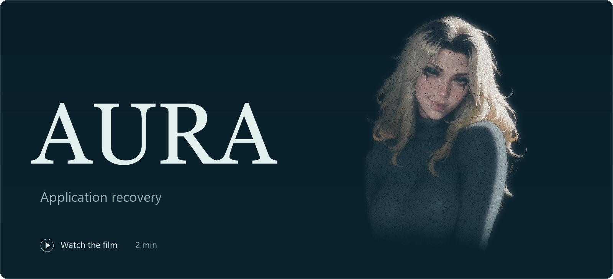
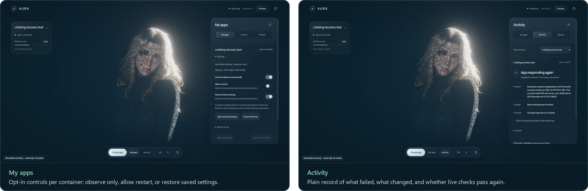
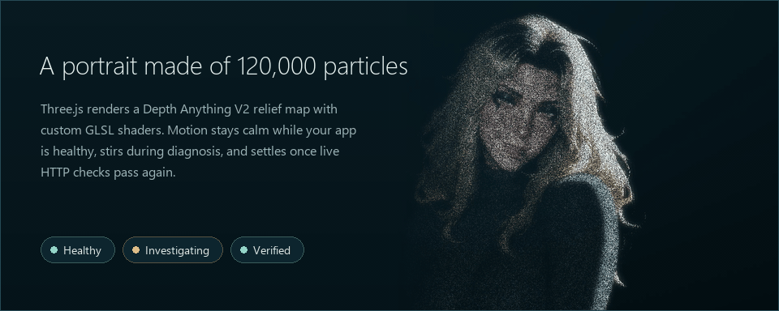
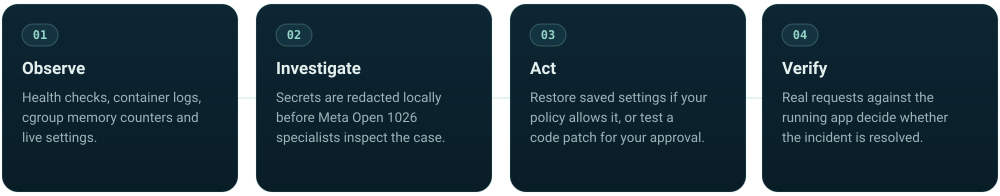
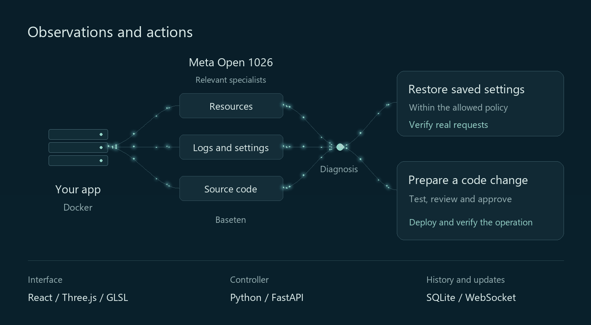
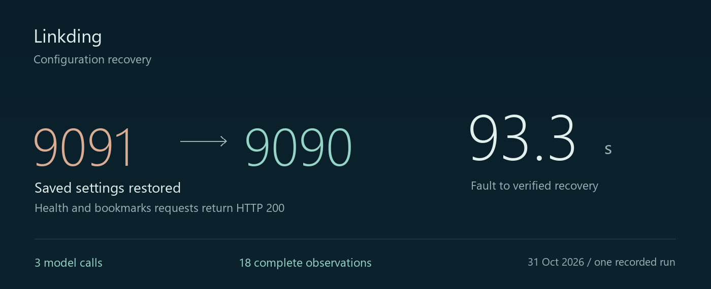
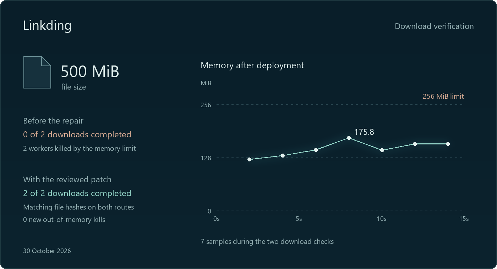
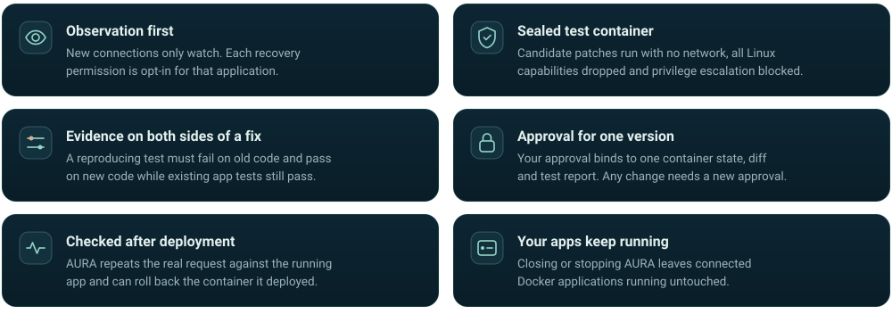
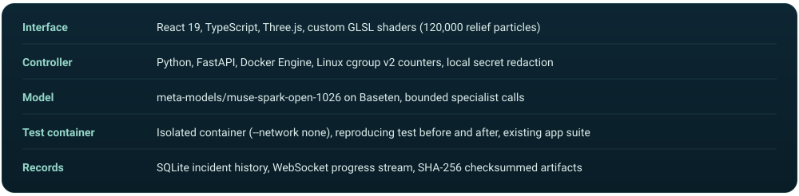

<div align="center">

<a href="https://gl1nome5.github.io/AURA/">
  
</a>

<br>
<br>

When a Python app in Docker stops responding, AURA works out why<br>
and checks the recovery against real requests.

<br>


<a href="LICENSE"></a>

<br>
<br>

[Try the live demo](https://aura.34.70.253.200.sslip.io/try) &nbsp;·&nbsp;
[Interface](#the-interface) &nbsp;·&nbsp;
[How it works](#how-it-works) &nbsp;·&nbsp;
[Results](#measured-on-linkding) &nbsp;·&nbsp;
[Guardrails](#guardrails) &nbsp;·&nbsp;
[Run locally](#run-locally)

</div>

<br>

AURA helps small teams look after Python applications running in Docker.
When an app stops responding, Meta AI agents inspect its logs, resource use and
settings. AURA can restore a saved configuration within permissions you set,
then check that real requests work again.

For a supported code defect, it can prepare a patch and test it in an isolated
container. You review the change and approve the specific version before deployment.

The [live demo](https://aura.34.70.253.200.sslip.io/try) gives each run a fresh
Linkding instance. Enter the supplied demo access code, then watch AURA investigate
and restore an intentionally changed port. No API key or local setup is needed.
[What the demo checks](docs/JUDGING_DEMO.md).

## The interface

The workspace centers on a particle portrait that reflects the state of the
selected container. Side drawers open when you connect an app, set recovery
permissions, or read an incident report.





<sub>Interface panels above show a saved recovery record in read-only review mode; the motion loop is captured from the Three.js particle scene.</sub>

## How it works



<br>



<sub>All runtime model calls use Meta Muse Spark Open 1026 through Baseten. The controller chooses the relevant specialists and limits each investigation. The animation illustrates the flow; it is not a recording of model activity.</sub>

## Measured on Linkding

A changed port left Linkding running but unreachable. AURA detected the failed
requests, compared the current settings with the saved configuration, and restored
the working port automatically.



<sub>One recorded run on a disposable Docker instance. Automatic restoration was enabled beforehand; no person intervened after the fault. <a href="docs/LIVE_RECOVERY.md">Run details and measurements</a></sub>

<br>

### A separate code repair

A historical Linkding defect buffered an entire file in memory. Under a 256 MiB
limit, neither of two 500 MiB downloads completed. The AI proposal needed a human
correction before AURA tested and deployed the approved patch.



<sub>Both routes returned the full file with matching hashes and no new OOM kills. The highest of seven memory samples was 175.8 MiB. <a href="docs/presentation/CASE_STUDY.md">Case study</a> · <a href="docs/presentation/case-data.json">Chart data</a></sub>

<details>
<summary>Reviewed patch and sandbox check</summary>

<br>

Before deployment, the isolated test runner (`--network none`, capabilities dropped,
privilege escalation blocked) ran four gates on the candidate image:

1. `1-collect` collected 51 existing Linkding asset tests (`exit_code=0`).
2. `1-before` ran three new regression checks against the unpatched code and confirmed the expected failure (`exit_code=1`).
3. `1-after` ran those three checks against the patched code (`exit_code=0`).
4. `1-original-suite` re-ran all 51 existing Linkding asset tests (`exit_code=0`).

The AI candidate first wrapped streams in a generator; a human edit switched both
asset routes (`bookmarks/views/assets.py` and `bookmarks/api/routes.py`) to
`FileResponse(file_obj)` so `close()` releases unconsumed file handles:

```diff
--- a/bookmarks/views/assets.py
+++ b/bookmarks/views/assets.py
@@ -3,6 +3,7 @@
 from django.conf import settings
 from django.http import (
+    FileResponse,
     Http404,
     HttpResponse,
 )
@@ -28,10 +29,18 @@
+def _open_asset_file(asset):
+    filepath = os.path.join(settings.LD_ASSET_FOLDER, asset.file)
+    if not os.path.exists(filepath):
+        raise Http404("Asset file does not exist")
+    if asset.gzip:
+        return gzip.open(filepath, "rb")
+    return open(filepath, "rb")
+
 def view(request, asset_id: int):
     asset = access.asset_read(request, asset_id)
-    content = _get_asset_content(asset)
-
-    response = HttpResponse(content, content_type=asset.content_type)
+    file_obj = _open_asset_file(asset)
+    response = FileResponse(file_obj, content_type=asset.content_type)
     response["Content-Disposition"] = f'inline; filename="{asset.download_name}"'
```

</details>

## Guardrails



## Under the hood



<details>
<summary>Operating limits</summary>

<br>

This local prototype supports up to three Docker applications and one active
investigation. Linkding is the repair case; Healthchecks was used to check
connection, observation and restart on a second application. Remote server fleets
and unattended production use have not been validated.

Code repair needs a configured source and test profile.

</details>

[Connection and repair profiles](docs/TARGET_MANAGEMENT.md) ·
[API](docs/OPS_API.md) · [Verification record](docs/FINAL_ACCEPTANCE.md) ·
[Still diagram](docs/readme/architecture.png)

## Run locally

Windows 10/11, Python 3.10+, [uv](https://docs.astral.sh/uv/getting-started/installation/),
Node.js 22.12+ and Docker Desktop with Linux containers.

```powershell
git clone https://github.com/GL1NoMe5/AURA.git
cd AURA
.\Start-AURA.cmd --setup
.\Connect-Baseten.cmd
.\Start-AURA.cmd
```

Open **[localhost:8000](http://127.0.0.1:8000/)**, choose **My apps**, then
**Connect an app**. The **?** button opens the guided tour.

You can skip `Connect-Baseten.cmd` to explore the interface without model calls.
Investigations require a compatible Baseten key and use provider credits.
The empty app starts without Docker; connecting containers requires it.

[Setup and troubleshooting](docs/CLEAN_START.md) · [Hosted judging demo](docs/JUDGING_DEMO.md)

<br>

<div align="center">

Built for the Meta Global AI Developer Hackathon<br>
<sub>AURA and portrait artwork by Emir · <a href="LICENSE">MIT code</a> · <a href="MEDIA_LICENSE.md">Media terms</a> · <a href="THIRD_PARTY_NOTICES.md">Credits</a></sub>

</div>
