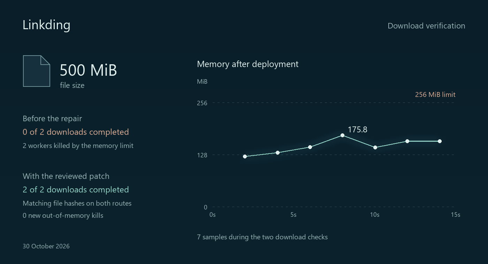

# Large files download again

An application can pass its health checks and still fail a real user operation.
This case follows a 500 MiB download through a historical Linkding defect and a
verified repair, in a Docker container with a 256 MiB memory limit.

## The problem

Linkding v1.46.2 buffered a file in memory before returning it. The test requested
the file through two download routes. Neither completed; the container's OOM-kill
counter increased by two. The file and workload were prepared for this test.
This reproduces a [historical upstream defect](https://github.com/sissbruecker/linkding/issues/1455).

## The change

An Open 1026 investigation produced a candidate correction. Human review amended
its file-close behavior and added a regression test. AURA then ran the
before/after and original-test checks, built the image, and deployed it through
the ordinary approval workflow. The operator approved that specific candidate.

The repair streams the file instead of first buffering the entire file in memory.
After deployment, AURA checked both actual downloads, including byte counts,
SHA-256 content hashes, memory samples and OOM counters, then recorded the
verified version.

## The result

| Measurement | Before | After |
| --- | --- | --- |
| Complete downloads | 0 of 2 | 2 of 2 |
| File size on each route | 500 MiB requested | 500 MiB received |
| Matching content hashes | No complete file | 2 of 2 |
| New OOM kills | 2 | 0 |

The chart contains seven actual **post-deployment** memory samples. Its highest
point is 184,339,660 bytes (175.8 MiB). Straight segments connect the observations;
they do not establish a continuous peak. The horizontal axis is elapsed time
during operation verification, not total investigation or repair time.

This is one human-assisted repair, recorded on 30 October 2026 on a Windows PC
with Docker Desktop Linux containers. It establishes this tested outcome, not an
autonomous repair success rate or support for arbitrary defects.

[Chart data](case-data.json) contains the exact plotted measurements and a
SHA-256 fingerprint of the source record. Private logs, credentials and runtime
identifiers are excluded. Subsequent autonomous attempts did not yield an
accepted repair; reliable autonomous patch generation remains ongoing work.

[Back to AURA](../../README.md)
